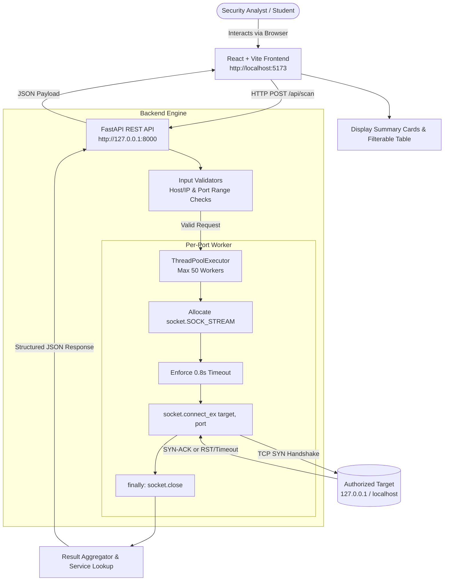

# Network Security Port Scanner

[](https://www.python.org/)
[](https://fastapi.tiangolo.com/)
[](https://react.dev/)
[](https://vitejs.dev/)
[](LICENSE)

> **STRICT EDUCATIONAL AUTHORIZATION NOTICE**  
> **This tool is intended ONLY for systems you own or have explicit permission to test.**  
> Unauthorized scanning, probing, or reconnaissance against networks or devices without prior written consent violates institutional computing policies and local, national, and international cybersecurity laws.

---

## 1. Project Overview

The **Network Security Port Scanner** is a modern full-stack cybersecurity application engineered to perform safe, bounded TCP connect scanning and service identification against authorized hosts. Built with a **FastAPI** backend utilizing Python's native `socket` library and an interactive **React (Vite)** dashboard, the application models how security analysts and system administrators evaluate perimeter exposure, audit active network daemons, and ensure adherence to the principle of least privilege.

---

## 2. Problem Statement

In contemporary network security and computer systems administration:
- Unused or misconfigured network daemons (e.g., legacy Telnet, exposed databases, unpatched remote desktop endpoints) present significant attack surfaces.
- Security practitioners require visibility into open network sockets to detect unintended exposures and verify firewall rule enforcement.
- Traditional command-line utilities (like Nmap) can be intimidating for beginners or obscure the underlying networking primitives (e.g., TCP handshakes and operating system socket abstractions).

This project addresses this need by providing a transparent, visual, and secure implementation of a TCP port scanner that clearly demonstrates underlying network fundamentals.

---

## 3. Objective

The objective of this college cybersecurity assignment is to build a professional, GitHub-ready software tool that demonstrates:
1. **Target Input**: Safe validation and resolution of IPv4 addresses and RFC-compliant hostnames.
2. **Port Range Selection**: Granular start and end port selection with safety limits (max 2,000 ports).
3. **Port Scanning**: Multi-threaded TCP connect scanning implemented directly using Python's `socket` library.
4. **Open/Closed Identification**: Deterministic detection of open versus closed/filtered ports.
5. **Clear Results**: Visual presentation featuring response latency, likely service mappings, and summary metrics.
6. **Robust Error Handling**: Graceful sanitization of DNS errors, timeouts, and malformed inputs without stack traces.
7. **Comprehensive Documentation**: Detailed architectural breakdowns, security policies, and faculty demo flows.

---

## 4. Features

- **Pure Python Socket Engine**: Directly initiates TCP connections via standard library sockets without invoking external binaries or OS shells.
- **Controlled Concurrency**: Multi-threaded scanning powered by `ThreadPoolExecutor` capped at 50 workers to prevent thread exhaustion or target flooding.
- **Service Name Resolution**: Automatic mapping of well-known IANA port numbers (HTTP, HTTPS, SSH, DNS, SMB, MySQL, RDP, Redis, etc.) labeled conservatively as *Likely Service*.
- **Cyber SOC Dark Theme**: High-contrast, dashboard interface featuring glowing status indicators, metric cards, and responsive tables.
- **Real-Time Client & Server Validation**: Double-layered protection preventing negative ports, inverted ranges, malformed hosts, and command injection characters.
- **Interactive Result Filtering & Search**: Instant filtering by status (`All`, `Open Only`, `Closed`) and real-time textual search by port number or service description.
- **Round-Trip Latency Measurement**: Millisecond-accurate socket timing for active connections.
- **Interactive Swagger Docs**: Built-in OpenAPI documentation available at `/docs`.

---

## 5. Technologies Used

### Backend
- **Python 3.10+**: Core programming language.
- **FastAPI**: Modern, high-performance web framework for building REST APIs.
- **Uvicorn**: Asynchronous ASGI web server implementation.
- **Python `socket` Library**: Native networking API for TCP stream sockets (`AF_INET`, `SOCK_STREAM`).
- **Pydantic v2**: Type enforcement, payload parsing, and serialization.
- **Pytest**: Automated test runner for unit, socket, and API integration testing.

### Frontend
- **React 18**: Component-based UI library.
- **Vite 6**: Fast next-generation frontend bundler and development server.
- **Lucide React**: Modern icon set for cybersecurity and telemetry indicators.
- **Modern CSS3**: Custom dark SOC theme utilizing CSS custom properties, grid, and flexbox.

---

## 6. Architecture



---

## 7. How Port Scanning Works

### The TCP Three-Way Handshake
TCP (Transmission Control Protocol) is a connection-oriented protocol that establishes communication sessions using a standardized three-step handshake:
1. **SYN (Synchronize)**: The client scanner sends a TCP segment with the `SYN` flag set to the target's destination port.
2. **SYN-ACK (Synchronize-Acknowledge)**:
   - If an application is actively listening on that port, the operating system kernel responds with a packet having both `SYN` and `ACK` flags enabled.
   - If the port is **closed**, the operating system kernel typically returns a packet with the `RST` (Reset) flag set.
   - If a firewall or packet filter drops the packet, no response is received before the socket timeout elapses.
3. **ACK (Acknowledge)**: When the scanner's operating system receives the `SYN-ACK`, it completes the connection by dispatching an `ACK` segment.

```text
Client Scanner                         Target Host
      |                                     |
      | -------- 1. TCP SYN --------------> |
      |                                     |
      | <------- 2. TCP SYN-ACK ----------- | (If Port is OPEN)
      |          OR TCP RST                 | (If Port is CLOSED)
      |                                     |
      | -------- 3. TCP ACK --------------> | (Connection Established)
      |                                     |
      | -------- 4. TCP FIN/RST (Close) --> | (Teardown Connection)
```

In this project, Python's `socket.connect_ex((ip, port))` triggers the operating system kernel to conduct this handshake:
- Return value `0`: Connection succeeded $\rightarrow$ marked **OPEN**.
- Non-zero return value (e.g. `10061 WSAECONNREFUSED` on Windows or `111 ECONNREFUSED` on Linux) or timeout $\rightarrow$ marked **CLOSED**.

---

## 8. Installation & Setup

### Prerequisites
- **Python**: Version 3.10 or higher installed (`python --version`).
- **Node.js**: Version 18 or higher installed (`node --version`).

### Step 1: Clone Repository
```bash
git clone https://github.com/your-username/network-security-port-scanner.git
cd network-security-port-scanner
```

### Step 2: Backend Setup
```bash
cd backend

# Create virtual environment
python -m venv venv

# Activate virtual environment
# Windows:
venv\Scripts\activate
# Linux/macOS:
source venv/bin/activate

# Install dependencies
pip install -r requirements.txt

# Start backend server
uvicorn main:app --reload --port 8000
```
The backend will start at `http://127.0.0.1:8000`. Verify by opening `http://127.0.0.1:8000/api/health` or `http://127.0.0.1:8000/docs`.

### Step 3: Frontend Setup
Open a **new terminal**:
```bash
cd frontend

# Install Node dependencies
npm install

# Start Vite development server
npm run dev
```
Open your browser to `http://localhost:5173`.

---

## 9. Usage Instructions

1. **Start Backend & Frontend**: Ensure both Uvicorn (port 8000) and Vite (port 5173) are running.
2. **Access Dashboard**: Navigate to `http://localhost:5173` in any modern web browser.
3. **Verify API Connectivity**: Check the top-right status pill. It should display **`API ONLINE (PORT 8000)`** in green.
4. **Configure Target**:
   - Enter `127.0.0.1` or click the **127.0.0.1 (Loopback)** quick-fill button.
5. **Configure Port Range**:
   - Set Start Port to `1` and End Port to `100` (or click **1 - 100 (Quick Demo)**).
6. **Initiate Scan**:
   - Click the **Start Scan** button.
   - The button will enter a loading state displaying *"Scanning Target..."*.
7. **Analyze Findings**:
   - Inspect the **Scan Mission Summary** cards showing total ports scanned, open count, closed count, and elapsed duration.
   - Review the **Port Discovery Log** table.
   - Use the **Open Only** filter button to isolate active services.
   - Filter by keyword (e.g. typing `http` or `80`) using the search box.
8. **Clear Results**:
   - Click **Clear** to reset the form and discovery logs.

---

## 10. Example Demonstration (Localhost)

For safe academic demonstration, scanning **`127.0.0.1` (localhost)** across ports **`1 - 100`** or **`1 - 8500`** is recommended:
- It eliminates external network dependencies.
- It guarantees that you are operating within strict legal and authorized boundaries.
- When running the backend on port `8000`, scanning ports `7990 - 8010` will immediately detect port `8000` as **OPEN** with service label `HTTP-Alt / Dev-Server (FastAPI/Django)`.

---

## 11. API Documentation

FastAPI provides automatic, interactive Swagger UI documentation at:
- **Interactive Documentation**: `http://127.0.0.1:8000/docs`
- **ReDoc Documentation**: `http://127.0.0.1:8000/redoc`

### Endpoints

#### 1. `GET /api/health`
Check backend server health.

**Response (200 OK)**:
```json
{
  "status": "ok",
  "message": "Network Security Port Scanner API is running"
}
```

#### 2. `POST /api/scan`
Executes an authorized port scan.

**Request**:
```json
{
  "target": "127.0.0.1",
  "start_port": 1,
  "end_port": 100
}
```

**Response (200 OK)**:
```json
{
  "target": "127.0.0.1",
  "ip_address": "127.0.0.1",
  "ports_scanned": 100,
  "open_ports": 1,
  "closed_ports": 99,
  "duration": 1.18,
  "results": [
    {
      "port": 80,
      "status": "closed",
      "service": "HTTP (Hypertext Transfer Protocol)",
      "response_time_ms": null
    },
    {
      "port": 8000,
      "status": "open",
      "service": "HTTP-Alt / Dev-Server (FastAPI/Django)",
      "response_time_ms": 1.84
    }
  ]
}
```

---

## 12. Error Handling

The application sanitizes errors at multiple layers:

| Error Condition | Handled At | User-Facing Message |
| :--- | :--- | :--- |
| **Empty Target** | Client & Backend | `Please enter a target host or IP address.` |
| **URL Scheme Entered** | Client & Backend | `Please provide only a hostname or IP address (remove 'http://', 'https://').` |
| **Shell Metacharacters** | Client & Backend | `Invalid target format. Target cannot contain spaces, slashes, or shell metacharacters.` |
| **Start Port > End Port** | Client & Backend | `Start port (100) cannot exceed end port (20).` |
| **Port Out of Bounds** | Client & Backend | `Start port must be between 1 and 65535.` |
| **Range > 2,000 Ports** | Client & Backend | `Port range too large. Please scan a maximum of 2000 ports at a time.` |
| **Unresolvable Host** | Backend | `Unable to resolve target host. Check your network connection, DNS settings, or host spelling.` |
| **Backend Offline** | Frontend | `Unable to communicate with the scanner backend. Ensure FastAPI is running on port 8000.` |

---

## 13. Security Considerations

- **Strict Authorization Boundary**: Clear unhideable warning banners on the dashboard, README, and `SECURITY.md`.
- **Zero OS Subshell Execution**: Sockets are instantiated strictly in Python memory space without shell execution (`subprocess`, `os.system`), neutralizing injection risks.
- **Resource Protection**: Max 50 worker threads and a hard limit of 2,000 ports per batch prevent Denial of Service (DoS) conditions.
- **Clean Socket Teardown**: Guaranteed socket closure (`finally: sock.close()`) prevents connection leakage in the host OS kernel.
- **Defensive Focus**: No stealth packet crafting (SYN scans requiring raw sockets/root privileges), no banner exploitation, and no credential brute-forcing.

---

## 14. Limitations

1. **TCP Connect Only**: Utilizes full TCP three-way handshakes. It does not perform SYN stealth scanning or FIN/Xmas scans (which require raw socket privileges).
2. **No UDP Scanning**: UDP port scanning is stateless and outside the project's educational TCP scope.
3. **No OS Fingerprinting**: Does not inspect TCP window sizes or TTL heuristics to infer the remote operating system.
4. **Likely Service Identification**: Service mappings are determined by standard IANA port assignments rather than active protocol interrogation.
5. **Firewall Sensitivity**: Stateful firewalls dropping inbound `SYN` packets may report ports as closed upon timeout.

---

## 15. Future Improvements

- **Opt-in Banner Grabbing**: Securely retrieving basic service banners (e.g. reading initial server greeting lines) with explicit user consent.
- **Report Exporting**: Exporting audit reports to CSV or JSON formats for documentation.
- **Scan History Log**: Client-side storage of previous scans for comparison.
- **Visual Port Heatmap**: Interactive graphical matrix representing port density.

---

## Screenshots

### Scanner Dashboard


### Scan Results


### Error Handling


*(Refer to [screenshots/README.md](screenshots/README.md) for capturing instructions during demonstration.)*

---

## Faculty Demonstration Guide (5 Minutes)

When presenting this project to your faculty, follow this structured demo flow:

1. **Introduction & Authorization (0:00 - 0:45)**:
   - Point out the unhideable **Security & Authorization Notice** banner.
   - Emphasize that the tool is strictly educational, strictly bounded, and engineered for authorized defense testing only.
2. **Architecture & Technology (0:45 - 1:30)**:
   - Explain the decoupling between the **React** frontend and the **FastAPI** backend.
   - Emphasize that scanning is implemented using Python's native `socket` library, not Nmap or external shell commands.
3. **Successful Localhost Scan (1:30 - 2:45)**:
   - Click the quick-fill **127.0.0.1** and preset **1 - 100** buttons.
   - Click **Start Scan**. Observe the loading indicator and fast execution time.
   - Review the **Scan Mission Summary** cards (total ports, open count, closed count, duration).
   - Filter by **Open Only** to highlight discovered ports and explain the *Likely Service* mapping.
4. **Input Validation & Error Handling (2:45 - 3:45)**:
   - Enter `127.0.0.1; ls` or `https://127.0.0.1` and show the immediate validation error.
   - Invert the port range (`Start: 500, End: 100`) to demonstrate range validation.
   - Request 3,000 ports (`1 to 3000`) and demonstrate the 2,000-port safety ceiling.
5. **Technical Explanation & Conclusion (3:45 - 5:00)**:
   - Scroll down to the **How TCP Connect Scanning Works** section on the dashboard.
   - Walk the faculty through the TCP 3-way handshake (`SYN` $\rightarrow$ `SYN-ACK` $\rightarrow$ `ACK`).
   - Mention that all 20 automated tests pass with `pytest`.

---

## Automated Testing

Run the automated test suite from the project root:

```bash
python -m pytest backend/tests/ -v
```

All 20 unit and integration tests validate:
- Target hostname and IPv4 validation
- Command injection character rejection
- Port boundary and range size enforcement
- Ephemeral socket connect scanning
- FastAPI REST endpoints (`/api/health` and `/api/scan`)

---

## License

This project is licensed under the [MIT License](LICENSE) with an academic and authorized testing disclaimer.
